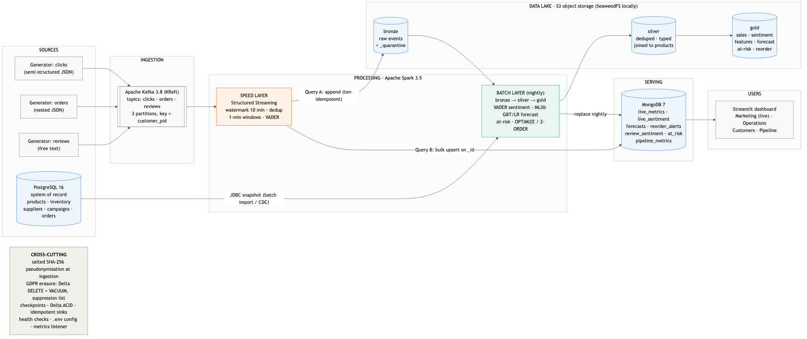
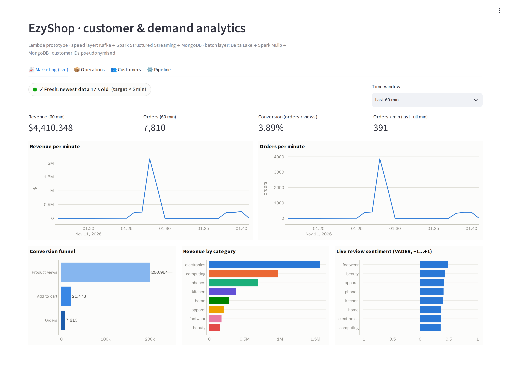
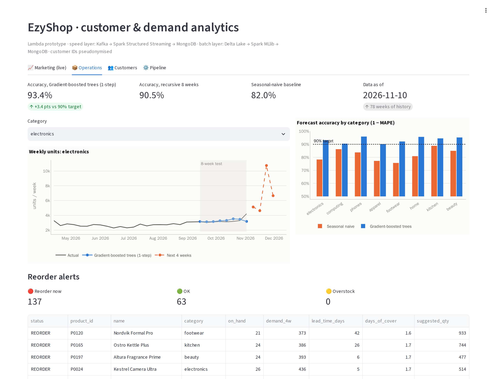
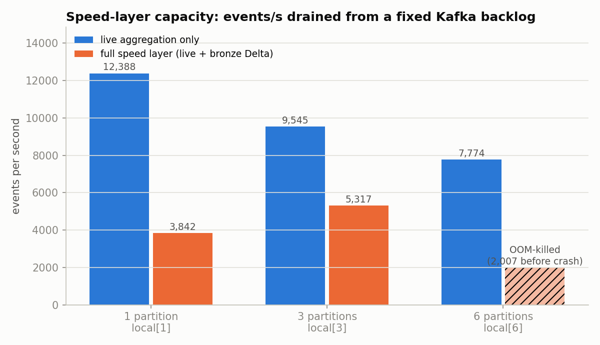
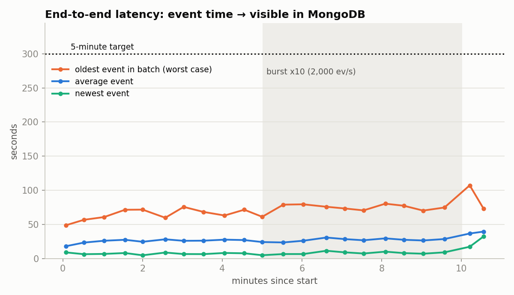
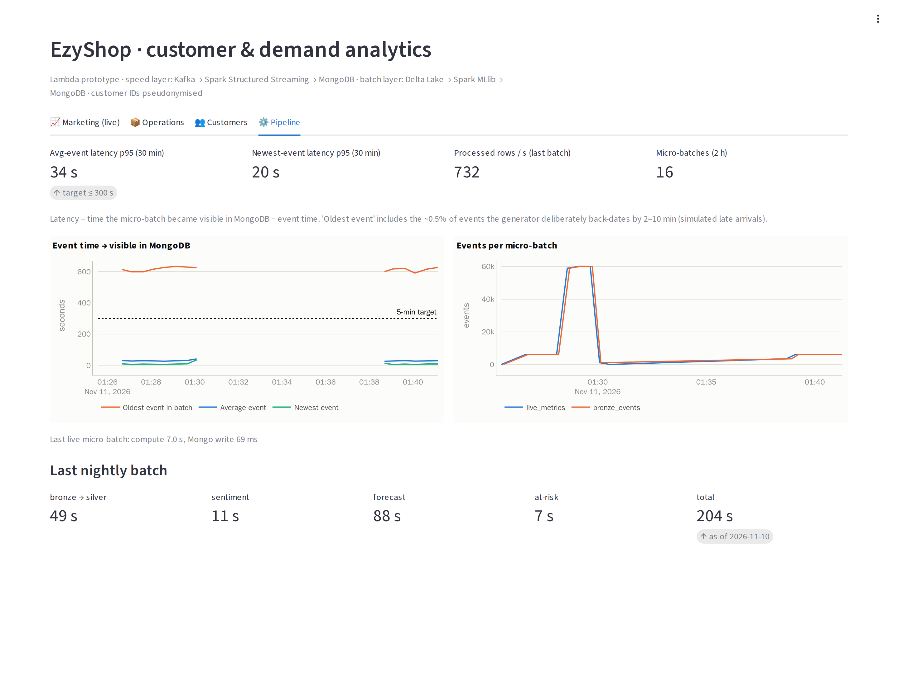

# EzyShop Big Data Prototype: Real-Time Customer Analytics and Demand Forecasting

> **DAT801A Big Data Architecture and Management · Assessment 3: Big Data Prototype**
> Author: **⟨AUTHOR NAME(S) — to be completed before submission⟩**
> Lecturer: Farshid Hajati
> Builds on the Assessment 2 report *EzyShop: Enhancing Customer Experience with Big Data* (Köberlein & Kinoti, 2026), cited here as "A2". This repository implements A2's Recommendation 5: *"validate assumptions with a small prototype."*

---

## Contents

1. [Introduction](#1-introduction)
2. [Prototype overview](#2-prototype-overview)
3. [Scope and scaling](#3-scope-and-scaling)
4. [Implementation instructions](#4-implementation-instructions)
5. [Interpreting the outputs](#5-interpreting-the-outputs)
6. [Results](#6-results)
7. [Design justification](#7-design-justification)
8. [Limitations and risks](#8-limitations-and-risks)
9. [Conclusion](#9-conclusion)
10. [References](#10-references)
11. [Use of AI declaration](#11-use-of-ai-declaration)

---

## 1. Introduction

EzyShop is a mid-sized online retailer of electronics, apparel and home goods. It runs all operations on one relational database and keeps its data in five silos: purchases, web clicks, reviews, inventory/suppliers and campaigns (International College of Management, Sydney, n.d.). A2 traced four business symptoms to this design: customer retention fell by 12% in six months; marketing has no current view of customer behaviour; the system fails at the 10,000 transactions per second (TPS) reached on peak days such as Black Friday; and the warehouse swings between overstock and shortage.

This prototype narrows that problem to one testable Big Data challenge: **real-time customer-behaviour analytics plus demand forecasting from integrated structured and unstructured data.** The challenge is defined by the three Vs:

| V | EzyShop figure (A2) | What makes it hard |
|---|---|---|
| **Volume** | 1 TB structured + 500 GB unstructured per day, +20%/yr: about 548 TB in year 1 and almost 2 PB after three years (A2 Appendix B) | A single relational server cannot store or scan this economically; storage and compute must scale independently |
| **Velocity** | Peaks of 10,000 TPS; marketing dashboard may lag by at most **5 minutes** | The peaks coincide with the days that matter most; the database must not be the buffer |
| **Variety** | Relational tables (products, inventory, suppliers, campaigns), semi-structured clickstream and order JSON with nested line items, and free-text reviews | The value is in *joining* them: one customer's clicks, purchases and complaints |

The business impact is direct. Retention loss and stock imbalance cost revenue every week, and Black Friday outages cost the most valuable sales of the year. The prototype therefore asks: *can a Lambda architecture built on open-source components (Kafka, Spark, Delta Lake, MongoDB) ingest a Black Friday-style burst, keep a marketing dashboard under five minutes old, forecast category demand to the 90% accuracy target, find at-risk customers from purchases plus review text, and honour GDPR erasure?* Section 6 answers each part with measurements.

---

## 2. Prototype overview

### 2.1 Architecture



*Figure 1. Prototype architecture (source: [`docs/architecture.mmd`](docs/architecture.mmd)). It mirrors the five layers of A2 Figure 1 at laptop scale.*

The prototype follows the **Lambda architecture** (Marz & Warren, 2015): the same events travel along a fast, approximate *speed layer* and a slower, complete *batch layer*, and both publish to one serving store. It implements A2's Rollout Step 1 (buffer + live dashboard) and the core of Step 2 (data lake + demand forecast), plus the churn early-warning from Step 3.

| Layer | Component (version) | Role in the prototype |
|---|---|---|
| Sources | Python generator (`confluent-kafka`, `Faker`); PostgreSQL 16 | Live clicks, orders and reviews; 18 months of history; the system of record (products, inventory, suppliers, campaigns, orders) |
| Ingestion | Apache Kafka 3.8.1, KRaft mode | Durable, partitioned buffer: 3 topics × 3 partitions, keyed by pseudonymised customer ID |
| Data lake | S3-compatible object storage (SeaweedFS 4.48 locally) + Delta Lake 3.2.1 on Parquet | Bronze → silver → gold medallion tables with ACID transactions, MERGE/DELETE and time travel |
| Processing | Apache Spark 3.5.3 (Structured Streaming, Spark SQL, MLlib) | Speed layer (1-minute windows) and nightly batch layer (cleaning, sentiment, forecast, at-risk, compaction) |
| Serving | MongoDB 7.0 | Pre-computed documents for the dashboard; idempotent upserts |
| Users | Streamlit 1.65 + Plotly | Marketing (live), Operations, Customers and Pipeline tabs |
| Cross-cutting | Salted SHA-256, Delta DELETE/VACUUM, checkpoints, health checks, `.env` | Pseudonymisation at ingestion, right to erasure, recovery, configuration |

### 2.2 Layer by layer

**Sources and ingestion.** The generator simulates about 5,000 customers browsing a 200-product catalogue in 8 categories. Each session follows a realistic funnel (views → add-to-cart → order → occasional review) and emits JSON events with an `event_id` (UUID), an ISO-8601 `event_time` and a `customer_pid`. The raw customer ID exists **only inside the generator**: `customer_pid = SHA-256(salt ‖ customer_id)` is computed before anything leaves it (GDPR Art. 4(5) and Art. 32(1)(a); *General Data Protection Regulation*, 2016). To exercise the cleaning logic, the generator deliberately injects about 1% duplicate events, about 0.5% late events (2–10 minutes old) and about 0.05% malformed messages. `--burst` multiplies the rate by 10 to simulate Black Friday. Kafka absorbs the load as a durable, partitioned log (Wang et al., 2015; Raptis & Passarella, 2023). Messages are keyed by `customer_pid`, so one customer's events stay ordered within one partition while partitions are processed in parallel (Raptis et al., 2024).

**Speed layer** ([`src/streaming/speed_layer.py`](src/streaming/speed_layer.py)). One Spark Structured Streaming application (Armbrust et al., 2018) runs two queries on the same Kafka stream:

* **Query A (raw → bronze)** parses each topic with an explicit schema, appends valid rows to `bronze/{clicks,orders,reviews}` (partitioned by `event_date`), and routes malformed or invalid records to `bronze/_quarantine` with a reason. Each table write passes Delta's `txnAppId`/`txnVersion = batch_id`, so a micro-batch replayed after a crash is skipped by Delta rather than written twice.
* **Query B (aggregates → MongoDB)** normalises all three topics in a single pass into "facts" per category. It applies a **10-minute watermark** and `dropDuplicatesWithinWatermark(event_id)`, aggregates **1-minute tumbling windows** (views, add-to-cart, orders, revenue, conversion, average VADER sentiment), and bulk-upserts one document per `(window_start, category)` on a deterministic `_id`. Replays therefore overwrite rather than double-count.
* A `StreamingQueryListener` stores every micro-batch's progress (input rows, rows/s, event-time min/avg/max, durations) in `pipeline_metrics`; the benchmarks and the Pipeline tab read it.

**Batch layer** ([`src/batch/run_nightly.py`](src/batch/run_nightly.py)), nightly, processing complete days only:

1. **bronze → silver**: snapshot `products`, `inventory`, `suppliers` and `campaigns` from PostgreSQL over **JDBC** (A2's "batch import / CDC" path); deduplicate events on `event_id`; explode nested order items and join them to the product master. *This is where semi-structured and structured data are integrated.*
2. **Sentiment**: VADER (Hutto & Gilbert, 2014) scores every review in a vectorised pandas UDF; scores are labelled pos/neu/neg and aggregated per product and per category-week, and checked against star ratings. *This is where unstructured data is integrated.*
3. **Forecast**: weekly units per category; features are lags 1/2/4/52, a rolling 4-week mean, week of year, month, a Black Friday flag, the category's sentiment in the previous week and the campaign count. Seasonal-naive, LinearRegression and GBTRegressor (Friedman, 2001) are compared on an 8-week hold-out; the best model forecasts the next 4 weeks and drives **reorder signals** against PostgreSQL inventory.
4. **At-risk customers**: an explainable score from a ≥50% fall in 30-day purchase frequency against the prior 90 days, and/or VADER-negative reviews, with a human-readable reason.
5. **OPTIMIZE + Z-ORDER** compact the small files that streaming creates and cluster rows by category.

**Serving and users.** MongoDB holds only small, pre-computed documents (A2 §2.1.2.4), so the dashboard never scans the lake. Streamlit re-renders each tab every 15 s with `st.fragment(run_every=…)`.

### 2.3 Data-flow walkthrough: one Black Friday add-to-cart

This extends A2 §2.1.4 with real component names and measured timings:

1. 20:14:05.312: customer *C01234* adds headphones (P0007) to the cart. The generator emits `{"event_id": …, "event_time": "…T20:14:05.312Z", "customer_pid": "9f3c…", "action": "add_to_cart", …}` to topic `clicks`, keyed by the pseudonym. The raw ID never leaves the generator.
2. Kafka appends it to partition `hash(pid) mod 3`. During the burst, events queue here instead of overloading a database.
3. Within one 30-second trigger, Query A writes the event unchanged to `bronze/clicks/event_date=…` (Delta, Parquet). Query B maps P0007 to `electronics`, adds it to the `20:14|electronics` and `20:14|__all__` windows, and upserts both documents into MongoDB.
4. The marketing dashboard shows the add-to-cart in the funnel on its next 15-second refresh. In the latency benchmark (Section 6.4), the average event was visible within **26 s (p50)** at normal load and **28 s (p50) / 38 s (p95)** in burst mode.
5. Overnight, the batch layer deduplicates the event in silver, includes it in the electronics demand history, and recomputes the 4-week forecast and the reorder signal for P0007. Operations see it the next morning.

### 2.4 Big Data techniques used

| Technique | Where | Why it matters for EzyShop |
|---|---|---|
| Distributed, partitioned commit log | Kafka topics, 3 partitions, key = pseudonym | Absorbs Black Friday bursts; parallel consumption; per-customer ordering |
| Micro-batch stream processing | Spark Structured Streaming, 30 s trigger | Exactly-once state with checkpoints; 5-minute freshness at modest cost (A2 §2.2.2.3) |
| Event-time windowing + watermarking | 1-minute tumbling windows, 10-minute watermark | Late mobile events still land in the right minute; state is bounded |
| Streaming de-duplication | `dropDuplicatesWithinWatermark(event_id)` | At-least-once delivery does not inflate KPIs |
| Idempotent sinks | Delta `txnAppId/txnVersion`; Mongo upsert on deterministic `_id` | Crash/restart without loss or double counting (Section 6.4) |
| Medallion lakehouse | bronze / silver / gold Delta tables | Raw data kept for re-processing; clean, joined and aggregated layers for each consumer |
| ACID tables on object storage | Delta Lake transaction log (Armbrust et al., 2020) | Concurrent stream + batch writers; DELETE for GDPR; time travel |
| Columnar storage + partitioning + data skipping | Parquet; `event_date`/`event_month` partitions; Z-ORDER by category | Queries read only relevant days and files |
| Small-file compaction | Delta `OPTIMIZE` | Streaming creates one file per partition per micro-batch |
| Distributed ML | Spark MLlib GBT and LinearRegression pipelines | Same engine and data as the rest of the pipeline (Hayat et al., 2025) |
| Lexicon-based NLP at scale | VADER in an Arrow-vectorised pandas UDF | Integrates free text cheaply and explainably |
| Pseudonymisation + erasure | Salted SHA-256 at ingestion; Delta DELETE + VACUUM; suppression list | Data protection by design (GDPR Arts. 17, 25, 32) |

---

## 3. Scope and scaling

**What the prototype is:** a faithful, runnable, scaled-down implementation of the A2 architecture on one laptop, with measured throughput, latency, accuracy and recovery behaviour, and recorded resource usage to feed A2's cost model.

**What it is not:** a production deployment. It runs one Kafka broker, local-mode Spark and single-node stores, so it cannot demonstrate fault tolerance across machines or reach 10,000 TPS. It uses synthetic data, so forecast and churn results show that the method works, not what EzyShop's real accuracy would be. It cannot measure the +25% personalisation target (there are no real users) or real cloud cost.

| Prototype component (laptop) | Production equivalent (A2 managed-services choice) | What changes |
|---|---|---|
| SeaweedFS S3 gateway (MinIO in the original plan; see TEST_LOG T01) | Amazon S3 / Azure ADLS Gen2 / Google Cloud Storage | Same S3A/ABFS API and Delta tables; tiered storage classes and lifecycle rules |
| One Kafka broker (KRaft), replication factor 1 | Managed multi-AZ cluster (Amazon MSK, Confluent Cloud), RF = 3, `min.insync.replicas` = 2 | More partitions (e.g. 24–48 per topic), broker redundancy, schema registry |
| Spark `local[3]` in one container | Databricks / Amazon EMR / Dataproc with auto-scaling; separate streaming and batch clusters | Executors across machines; the code is unchanged |
| MongoDB container | MongoDB Atlas (replica set, sharded by category or customer) or DynamoDB | High availability, horizontal write scaling |
| PostgreSQL container | Managed PostgreSQL (RDS/Aurora) with read replicas, sharded by customer ID (A2 §2.2.2.2) | CDC (e.g. Debezium) instead of nightly JDBC snapshots |
| Streamlit container | Streamlit/BI tool behind SSO, or an internal web app | Role-based access, caching |
| Python generator | EzyShop web/app servers emitting events through a load balancer | Real traffic and real customer IDs, hashed at the edge |

---

## 4. Implementation instructions

### 4.1 System requirements

* macOS (Apple Silicon or Intel), Linux, or Windows 11 with WSL2
* **Docker Desktop** (or Docker Engine + Compose v2) with **≥ 8 GB RAM and ≥ 4 CPUs** allocated (developed on an M3 Pro with 12 CPUs and 7.7 GiB for Docker)
* About **10 GB** of free disk (images about 4 GB; data volumes grow with run time)
* `make` (preinstalled on macOS/Linux) and internet access for the first build only
* Ports 8501, 8333, 9333, 9094, 27017, 15432 and 14040 free (all configurable in `.env`)

### 4.2 Dependencies

Only **Docker** and **make** are needed on the host; everything else is containerised and pinned. Every image is multi-arch (linux/arm64 + linux/amd64), and the Spark packages are downloaded once at image build time, so runs do not need Maven:

| Image | Contents |
|---|---|
| `apache/kafka:3.8.1` | Broker + controller (KRaft, no ZooKeeper) |
| `chrislusf/seaweedfs:4.48` | S3-compatible object store for the lake |
| `mongo:7.0.43`, `postgres:16.14` | Serving store and system of record |
| `ezyshop/spark` (built from `docker/spark/Dockerfile`) | Python 3.11, OpenJDK 17, PySpark 3.5.3, delta-spark 3.2.1, spark-sql-kafka 3.5.3, hadoop-aws 3.3.4, aws-java-sdk-bundle 1.12.262, PostgreSQL JDBC 42.7.12, vaderSentiment 3.3.2, pymongo, pytest, matplotlib |
| `ezyshop/generator`, `ezyshop/dashboard` | confluent-kafka + Faker; Streamlit 1.65 + Plotly 6.9 |

### 4.3 Step-by-step

```bash
cp .env.example .env          # local settings; `make up` also does this if .env is missing
make up                       # build images (first build ~6-8 min), start all services, wait until healthy
make init                     # create Kafka topics (3x3), the lake bucket, seed PostgreSQL
make backfill                 # 18 months of history -> bronze Delta (~1.5 min)
make stream                   # terminal 1: speed layer (Ctrl-C to stop)
make generate                 # terminal 2: live events at EVENTS_PER_SEC (Ctrl-C to stop)
open http://localhost:8501    # the dashboard
make burst                    # terminal 2: Black Friday x10 for 180 s
make nightly                  # batch layer (~3 min)
make erase CUSTOMER=C00042    # GDPR erasure demo
make test                     # unit tests (29)
make test-integration         # end-to-end smoke test + GDPR test (~8 min)
make bench                    # capacity + latency benchmarks (~35 min)
make down                     # stop (keeps data); `make clean` also deletes all data
```

`make demo` runs `up → init → backfill →` a scripted stream with normal traffic and a burst `→ nightly` in one go (11 min 22 s measured from a fresh clone with cached images; add ~8 min for the first image build). `make help` lists every target.

### 4.4 Expected output at each step

| Step | What you should see |
|---|---|
| `make up` | Seven containers listed by `docker compose ps`, all `(healthy)` |
| `make init` | Three topics with `PartitionCount: 3`; `bucket ezyshop-lake created` (or `already exists`); `Postgres seeded: suppliers=20 products=200 inventory=200 campaigns=76` |
| `make backfill` | `generated ~646,000 orders and ~44,000 reviews (… 18 months …)`, then `bronze/orders: … rejected=0` |
| `make stream` | `speed layer: master=local[3] trigger=30s …`; Spark warnings about adaptive execution are expected |
| `make generate` | A line every 5 s: `sent=… rate=200/s clicks=… orders=… reviews=… dup=… late=… bad=…` |
| Dashboard | Green **✓ Fresh** badge within about a minute; KPIs and charts update every 15 s (Figure 2) |
| `make nightly` | One line per step: `[silver] …`, `[sentiment] …`, `[forecast] … one-step accuracy …`, `[at-risk] …`, `[optimize] …`, then `nightly batch finished in ~200 s` |
| `make erase …` | Per-table counts before/after, e.g. `bronze/orders rows before 112 after 0 …` (full output: [`docs/gdpr_erasure_demo.txt`](docs/gdpr_erasure_demo.txt)) |


*Figure 2. Marketing (live) tab during a run.*

### 4.5 Troubleshooting

| Symptom | Fix |
|---|---|
| `port is already allocated` | Change the `HOST_PORT_*` value in `.env` (e.g. `HOST_PORT_POSTGRES=15433`) and run `make up` again |
| Containers restart or Spark is killed (`exit 137`) | Give Docker Desktop more memory (Settings → Resources, ≥ 8 GB) or lower `SPARK_DRIVER_MEMORY` in `.env`; stop other running stacks |
| First `make up` is slow | Building the Spark image downloads about 1.2 GB (JDK, PySpark, jars); later builds are cached |
| Stream fails with `There are [N] sources in the checkpoint offsets …` | The query plan changed since the last run; `docker compose exec spark python scripts/reset_stream.py` deletes the checkpoints (Mongo upserts are idempotent, so re-aggregation is safe) |
| Dashboard says "No live data yet" | `make stream` and `make generate` must both be running; the first window appears after about 30–60 s |
| Forecast/at-risk tabs empty | Run `make backfill` then `make nightly` |

---

## 5. Interpreting the outputs

### 5.1 Dashboard

| Panel | Meaning | How the business acts on it |
|---|---|---|
| **Freshness badge** (Marketing) | Age of the newest event that is visible. Green under 5 min, amber 5–15 min, red otherwise, with icon and label | The 5-minute requirement made visible; if it turns amber during a sale, the pipeline is falling behind and capacity should be added (A2 risk 3) |
| Revenue / orders per minute | Store-wide totals from the `__all__` windows, so each order is counted once | Spot a campaign taking off, or a checkout problem (orders flat while views rise) within minutes |
| Conversion funnel | Views → add-to-cart → orders in the selected window | A sudden drop in cart→order points to payment or stock problems |
| Revenue by category | Category share in the window. An order counts in each category it contains, with that category's share of revenue | Shift ad spend towards categories that are converting today |
| Live review sentiment | Average VADER compound score per category (−1 to +1) | A category turning negative during a sale is an early warning of a quality or delivery problem |
| Forecast vs actual (Operations) | 30 weeks of history, the 8-week test with the best model's 1-step forecast, and the next 4 weeks | Planners see how close the model tracked reality and the upcoming peak |
| Accuracy by category | 1 − MAPE per category for the model and the seasonal-naive baseline, against the 90% target | Where the forecast can be trusted, and where safety stock should stay higher |
| Reorder alerts | Products whose stock is below demand over the supplier lead time plus safety stock, with suggested quantities | The buying team's work list (A2's overstock/shortage problem) |
| At-risk customers (Customers) | Pseudonymised IDs, score 0–100 and a plain-English reason | Retention campaigns (voucher, service call) for the top of the list; addresses the 12% retention loss |
| Lowest-sentiment products; weekly sentiment by category | Products with the worst review language; category trends over 26 weeks | Quality follow-up with suppliers; the planted quality shocks are visible as dips |
| Pipeline tab | Latency per micro-batch against the 5-minute line, events per batch, nightly step timings | Operations monitoring; inputs for capacity planning and the cost model |

### 5.2 Gold tables (Delta, `s3a://ezyshop-lake/gold/…`)

| Table | Grain | Used for |
|---|---|---|
| `daily_category_sales` | category × day: units, revenue, orders | Demand history, BI |
| `review_sentiment` | product: reviews, avg compound, % pos/neg, avg stars | Product quality, supplier conversations |
| `category_week_sentiment` | category × week | Forecast feature, trend chart |
| `category_week_features` | category × week: all model features | Reproducible model training |
| `forecast_eval` | category × test week: actual and predictions of every model | Accuracy reporting |
| `forecast` | category × next 4 weeks | Planning |
| `reorder_signals` | product: stock, 4-week demand, lead time, status, suggested quantity | Purchasing |
| `at_risk_customers` | pseudonymised customer: score, reason, signals | Retention campaigns |

Small extracts of the inputs and outputs are committed in [`sample_data/`](sample_data/).

---

## 6. Results

All figures were measured on the development MacBook Pro (M3 Pro, Docker Desktop with 12 CPUs / 7.7 GiB). Raw data: [`tests/bench/results/`](tests/bench/results/). Every issue found along the way is in [`docs/TEST_LOG.md`](docs/TEST_LOG.md).

**Test environment caveat.** The Docker VM (12 vCPU, 7.65 GiB) was shared with unrelated containers using about 2 GB, and the host (6 performance + 6 efficiency cores) also ran other heavy workloads, including an Android emulator (macOS load average 6–9 during the benchmarks). Absolute numbers are therefore conservative, and run-to-run variation of about ±10% was observed.

### 6.1 Summary against the case-study targets

| Target (A2) | Result | Verdict |
|---|---|---|
| Dashboard latency ≤ 5 min | Average event visible in **26–28 s** (p50/p95) at normal load and **28–38 s** in a ×10 burst; worst event in any batch ≤ **107 s** | Met with ~3–10× headroom |
| Forecast accuracy ≥ 90% (1 − MAPE, category × week) | GBT **93.4%**, LinearRegression 93.3%, seasonal-naive 82.0% (one-step); recursive 8-week GBT **90.5%** | Met on synthetic data (see 6.2 caveat) |
| 10,000 TPS peak | Measured laptop capacity of the full speed layer: **5,317 events/s** on 3 cores (bronze-bound); extrapolation in 6.3 | Not reachable on a laptop; trend + extrapolation only |
| Integrate structured + semi-structured + unstructured | Orders (nested JSON) ⨝ Postgres products (JDBC); VADER on 46,120 free-text reviews feeds the forecast and the churn score | Demonstrated |
| GDPR pseudonymisation + erasure | Salted SHA-256 at ingestion; erasure removed 476 rows across the Delta tables (10 checked) + Mongo + Postgres; suppression stops re-ingestion; VACUUM shown to make it physical | Demonstrated and tested |
| Reliability | Hard kill of Spark mid-batch: no loss, no duplicates, no double counting | Demonstrated (T04, T07) |
| Personalisation +25%, cost ≤ $1.5M | Not measurable without real users / cloud deployment; resource usage recorded (6.7) | Out of scope (stated) |

### 6.2 Demand forecast (batch layer)

78 complete weeks per category; the last 8 weeks (2026-09-14 to 2026-11-02) are the hold-out; data as of 2026-11-10.

| Category | Seasonal naive | Linear regression | **GBT (selected)** | GBT recursive 8 weeks |
|---|---|---|---|---|
| apparel | 77.2% | 90.4% | 90.1% | 93.8% |
| beauty | 85.0% | 94.7% | 95.2% | 86.3% |
| computing | 86.3% | 91.8% | 90.5% | 92.4% |
| electronics | 78.3% | 96.0% | 93.2% | 85.1% |
| footwear | 75.7% | 91.4% | 92.2% | 90.0% |
| home | 80.9% | 95.0% | 95.7% | 90.8% |
| kitchen | 88.8% | 94.6% | 94.5% | 92.8% |
| phones | 83.8% | 92.4% | 95.9% | 93.2% |
| **overall** | **82.0%** | **93.3%** | **93.4%** | **90.5%** |

*Accuracy = 1 − MAPE (A2 Assumption 8). One-step = each test week predicted from actual history up to the previous week; recursive = predictions fed back as lags for 8 weeks (closer to how planners use a forecast).*

**Interpretation.** Both ML models beat the seasonal-naive baseline by about 11 points, because the baseline ignores the 25% growth trend and the campaign calendar. GBT and LinearRegression are statistically indistinguishable here: an earlier run on the previous day's data selected LinearRegression (94.0% vs 93.8%), this run selects GBT (93.4% vs 93.3%). The recursive 8-week accuracy (90.5%) only just clears the target, and two categories (electronics 85.1%, beauty 86.3%) fall below it. **The 90% result is favourable because the synthetic demand follows a multiplicative seasonal model that the features can represent** (trend, Nov/Dec peak, Black Friday, campaign uplift, planted quality shocks). On real data, new products, stock-outs that censor demand and competitor effects would lower it, so A2's risk 4 and its countermeasures (safety stock, planner judgement) stand. MAPE also has known weaknesses near zero demand (Hyndman & Koehler, 2006), which is why category × week, not product × day, is the reported level.

**Reorder signal.** For the next 4 weeks (which include Black Friday 2026), 137 of 200 products are below their reorder level (forecast demand over the supplier lead time + safety stock) and none are overstocked. A high share is expected right before the peak; after calibrating stock to demand, the share fell from 194/200 (T09).


*Figure 3. Operations tab: forecast vs actual for electronics with the 8-week test window, the next 4 weeks, accuracy per category against 90%, and reorder alerts.*

### 6.3 Throughput and the 10,000 TPS question

**Controlled capacity test** ([`tests/bench/throughput.py`](tests/bench/throughput.py)): a fixed backlog of about 450,000 events is loaded into fresh topics *before* Spark starts, then drained with P partitions = P cores.

| Partitions / cores | Live aggregation only | Full speed layer: live | Full speed layer: bronze (limiting stage) |
|---|---|---|---|
| 1 / `local[1]` | **12,388** ev/s | 9,315 | **3,842** |
| 3 / `local[3]` | 9,545 | 10,180 | **5,317** (+38%) |
| 6 / `local[6]` | 7,774 | (OOM-killed) | (OOM-killed) |


*Figure 4. Speed-layer capacity from a fixed backlog.*

**What this shows, honestly.** In the full speed layer, the bronze Delta writer (object-store commits) is the bottleneck, and it does scale with partitions: +38% from 1 to 3 cores, because each Kafka partition's slice is written in parallel. The live aggregation does **not** scale on this laptop: it gets slower with more cores. A Spark stage profile explains why: for the same 200,000 events, total task time rose from 21.2 s to 121.6 s (1 → 6 cores) while JVM CPU rose only from 6.9 s to 18.5 s. The extra tasks spend their time waiting for one Python worker each (the VADER UDF), fixed per-batch state-store commits and a host whose CPUs and memory were already contended (T11). Six task slots plus their Python workers did not fit in memory next to the bronze writer (OOM, T12). A load sweep with the generator in the same container confirmed the picture but is confounded by CPU sharing ([`load_sweep.png`](tests/bench/results/load_sweep.png)).

**A laptop cannot reach 10,000 TPS, and this prototype does not claim to.** The evidence is the per-stage capacity and the fact that the limiting stage scales with partitions. Extrapolation, stating the assumptions:

* Per-core capacity of the full speed layer, taken from the configuration that fitted in memory: 5,317 ev/s ÷ 3 cores ≈ **1,770 events/s per core**.
* *Reading 1 (A2 Table 1: 10,000 events/s reach the buffer):* 10,000 ÷ 1,770 ≈ 6 cores; with 2× headroom for bursts and recovery, **≈ 12 cores** (e.g. 3 executors × 4 cores), plus a Kafka topic with ≥ 12 partitions. A2's cost model assumed 12 speed-layer *machines*; the measurement suggests that is generous for this reading.
* *Reading 2 (10,000 orders/s, with clicks on top):* orders are about 3.3% of events in the generator, so ≈ 300,000 events/s, ≈ 170 cores, ≈ 340 cores with headroom (about 43 eight-core machines). That is within A2's separate "peak capacity: 100 machines for 10 days" line (Table B2), but it is the reading the prototype should be load-tested against before Black Friday.
* Assumptions: stateless parsing and the bronze append scale near-linearly with partitions and executors, as Kafka consumer groups and Spark tasks parallelise per partition (Raptis et al., 2024; Armbrust et al., 2018). Stateful aggregation scales with shuffle partitions. Each executor in a cluster has its own cores, memory and network, unlike the shared laptop. Cloud object stores have higher per-request latency than local SeaweedFS, so bronze commits should be fewer and larger (longer bronze trigger) in production.

**Tuning that mattered** (full list: TEST_LOG summary): `spark.sql.shuffle.partitions` = 6 instead of the default 200 gave **8,941 vs 1,512 ev/s (5.9×)** on the same backlog; bounding `maxOffsetsPerTrigger` (200k) stopped the JVM from being OOM-killed during bursts.

### 6.4 End-to-end latency

Production settings: 3 partitions, `local[3]`, 30-second trigger, 1-minute windows, 10-minute watermark; late-event injection off (those events are back-dated on purpose).

| Phase | Offered | Batches | Newest event p50 | **Average event p50 / p95** | Oldest event in batch p95 / max | ≤ 300 s? |
|---|---|---|---|---|---|---|
| Normal | 200 ev/s | 12 | 6.6 s | **25.9 s / 27.8 s** | 77.1 s / 78.9 s | ✓ |
| Burst ×10 | 2,000 ev/s | 10 | 9.0 s | **28.4 s / 38.1 s** | 95.1 s / 107.2 s | ✓ |


*Figure 5. Latency per micro-batch; the shaded area is the ×10 burst.*

The average event becomes visible within about half a minute, dominated by the 30-second trigger, and stays under 40 s in the burst: about **8× headroom** against the 5-minute requirement. The "oldest event" column is a worst-case upper bound and includes the generator's session model: a session's first page view is time-stamped up to tens of seconds before the session is emitted. A shorter trigger would lower latency at the cost of more, smaller commits; A2's choice of minute-level windows (§2.2.2.3) is confirmed as sufficient.

### 6.5 Sentiment validation (unstructured data)

VADER labels compared with a star-rating label (4–5 pos, 3 neu, 1–2 neg) on **46,120 reviews**:

| Stars ↓ / VADER → | neg | neu | pos |
|---|---|---|---|
| **neg (1–2★)** | 5,763 | 649 | 2,125 |
| **neu (3★)** | 3,263 | 2,657 | 6,270 |
| **pos (4–5★)** | 1,218 | 2,157 | 22,018 |

Three-class agreement **66.0%**; positive/negative-only agreement **81.9%**; Pearson r (compound vs stars) **0.637**. The weak spots are the ones a lexicon model is known for. Three-star reviews ("fine for the price") are mostly read as positive. 2,125 negative reviews scored positive, which is where the generator's sarcasm ("Great, it broke after two days") lives; a unit test documents that failure. For marketing triage and as an aggregate signal (category-week averages, churn input) this is adequate; for individual decisions a fine-tuned transformer would be the upgrade (Section 7).

### 6.6 At-risk customers and GDPR erasure

**At-risk** (as of 2026-11-10): 764 of 5,000 customers flagged (626 by falling purchase frequency, 188 by negative reviews, 50 by both). Scored against the churn cohort the generator planted (400 customers): **precision 0.444, recall 0.848, precision of the top 100 by score 0.83**. Marketing would work down the ranked list, so the top of the list is what matters. Thresholds were tuned on a 27-setting grid (T10).

**Erasure** of customer C00042 ([`docs/gdpr_erasure_demo.txt`](docs/gdpr_erasure_demo.txt)): 476 rows deleted across 8 Delta tables (bronze, silver), with zero remaining, plus Mongo and Postgres checks and an audit record that stores no raw ID. All 476 rows were still readable through Delta time travel immediately after the DELETE. [`docs/gdpr_vacuum_demo.txt`](docs/gdpr_vacuum_demo.txt) shows that after `VACUUM` (forced to 0 hours for the demo), time travel to the pre-delete version **fails** because the Parquet files are physically gone. Erasure is therefore "DELETE now + VACUUM within the retention window", and Kafka's 24 h retention bounds the broker copy. The suppression list kept the erased customer out of 235,280 newly ingested click rows (T14). The automated test `tests/integration/test_gdpr_erasure.py` passes.

### 6.7 Reliability, tests and resource usage

* **Recovery** (T04, T07): the Spark container was hard-killed (`docker kill`) mid-stream twice, once between batches and once during a running job, while the generator kept producing. After restart: Kafka messages = bronze rows + quarantined rows for every topic, zero duplicate offsets, and Mongo order/view totals equal the distinct events in bronze. In the second test the in-flight batch had committed 2 of 3 bronze tables; on replay Delta skipped them and wrote only the third.
* **Tests:** 29 unit tests (pseudonymisation, schemas and cleaning, generator, sentiment, speed-layer facts, forecast features and time-split leakage) and 3 integration tests (end-to-end stream, nightly outputs, GDPR erasure) pass. `make demo` from a fresh clone after `make clean` completed in **11 min 22 s**.
* **Nightly batch:** 204 s end to end on 653k orders / 46k reviews (silver 49 s, sentiment 11 s, forecast 88 s, at-risk 7 s, OPTIMIZE ~16 s).
* **Steady-state resources at 200 ev/s** (`docker stats`, 8 samples, [`docker_stats_steady_200eps.csv`](tests/bench/results/docker_stats_steady_200eps.csv)):

| Service | CPU mean (max) | Memory |
|---|---|---|
| Spark (both streaming queries) | 189% (493%) | 2.6 GB |
| Kafka | 11% (42%) | 463 MB |
| SeaweedFS (object store) | 7% (19%) | 795 MB |
| MongoDB | 4% (21%) | 181 MB |
| Dashboard / generator / Postgres | 4% / 5% / 0% | 142 / 31 / 28 MB |

For A2's cost model: the speed layer at 200 ev/s needs about two cores and 2.6 GB on average, so compute scales with event rate per §6.3; storage and serving are minor at this volume.


*Figure 6. Pipeline tab: latency per micro-batch, events per batch (the burst is the 60k peak), nightly step timings.*

---

## 7. Design justification

Each decision below gives the alternative considered, why this option was chosen *for EzyShop*, what it costs, and how the prototype tested it. It extends A2 Table 2.

| Decision | Alternative(s) | Why this one | Trade-off accepted | Prototype evidence |
|---|---|---|---|---|
| **Lambda** (speed + batch) | Kappa: one streaming path, history replayed from the log (Lin, 2017; Maatallah et al., 2025) | The forecast needs 18+ months of history with features such as lag-52; the dashboard needs minutes. One engine (Spark) for both keeps the duplicated logic small | Two code paths must agree (e.g. how an order counts per category) | Shared parsing (`src/common/bronze.py`) and sentiment code; streaming revenue reconciles with bronze (Section 6.4) |
| **Kafka** | RabbitMQ (queue, messages deleted on consumption); Amazon Kinesis (managed, shard limits, AWS-only) | A replayable, partitioned log is what makes checkpoint recovery and re-processing possible (Wang et al., 2015); open source avoids lock-in (A2 risk 5); managed options (MSK, Confluent) exist | Operating Kafka well needs skills (A2 risk 6) → use a managed service in production | Hard kill of Spark mid-batch: no loss, because Spark re-read the uncommitted offsets from Kafka (T07) |
| **Spark** for both paths | Apache Flink (true streaming, millisecond latency) | One API and engine for SQL, streaming and ML (Zaharia et al., 2016) means fewer skills and less glue for a small team (A2 §2.2.1). The requirement is 5 minutes, not 5 ms | Micro-batch latency is seconds, not milliseconds; Flink would be the upgrade path if sub-second use cases appear (Vogel et al., 2024) | Average-event latency 26–38 s against 300 s (Section 6.4) |
| **Delta Lake** on Parquet | Plain Parquet (no transactions); Apache Iceberg; Apache Hudi (Jain et al., 2023) | ACID appends from two writers, DELETE for erasure, `txnAppId` idempotent streaming writes and time travel (Armbrust et al., 2020). Iceberg is equally capable and more engine-neutral; Delta was chosen for its tight Spark integration and A2 continuity | Ecosystem tilt towards Spark/Databricks; Iceberg remains a viable migration (open Parquet underneath) | DELETE of one customer across 10 tables (6.6); replayed partial batch skipped by Delta (T07); OPTIMIZE 72 → 1 files (T08) |
| **Object storage** (S3 API) | HDFS on a self-run Hadoop cluster | Storage and compute scale and are paid for separately; nearly 2 PB in 3 years needs tiering, not servers running only to hold disks (A2 §2.2.1; A. Q. Khan et al., 2024) | Higher per-request latency than local disks; eventual listing semantics needed Delta's log | Six Delta commits per micro-batch made the bronze query the bottleneck (T05/T11): object-store latency is real |
| **MongoDB** serving store | Cassandra (write-optimised wide-column; Lakshman & Malik, 2010); Redis (in-memory cache) | Documents fit the dashboard's read shapes (one window per category, one forecast per category with arrays); flexible schema; upsert on `_id` gives idempotent sinks | Weaker multi-document consistency (Ferreira et al., 2025), so orders stay in PostgreSQL (A2 §2.2.1); Cassandra would scale writes further | Bulk upserts of about 45 window documents per batch in tens of milliseconds (15–69 ms observed) |
| **foreachBatch + pymongo** | MongoDB Spark Connector | No extra jar or version matrix to maintain; explicit control of idempotent `$set` upserts and of latency metrics | Collects aggregates to the driver: fine for window aggregates (tens of rows per batch), wrong for raw events | Restart tests show no double counting (T04, T07) |
| **VADER** sentiment | Transformer models such as BERT (Devlin et al., 2019) | No training data, no GPU, tens of thousands of reviews per second in a pandas UDF, and every score is explainable to marketing (Hutto & Gilbert, 2014) | Misreads sarcasm and mixed reviews: 66.0% three-class agreement with stars (6.5). A fine-tuned transformer would raise accuracy at much higher compute cost | Unit test documents the sarcasm failure; validation against stars |
| **GBT / LinearRegression** (MLlib) at category × week | ARIMA (Hyndman & Athanasopoulos, 2021); Prophet (Taylor & Letham, 2018) | One global model across categories, with exogenous features (campaigns, sentiment, Black Friday) inside the same distributed pipeline; ARIMA/Prophet are per-series and run outside Spark | Trees cannot extrapolate beyond the training range, hence the ratio-to-rolling-mean target; few Black Friday examples | Both models beat the seasonal-naive baseline by about 11 points; GBT and LR within 0.2 points of each other (6.2) |
| **Managed services in production** | In-house Hadoop | Small team, predictable cost (Dziubak, 2023; A2) | Unit price, less control | Resource figures (6.7) feed the A2 cost model |

**Critical reflections.**

* *Was Lambda over-engineered?* At prototype scale the batch layer recomputes silver in full every night (≈ 49 s for 653k orders). At 1 TB/day that would be the first thing to change, to incremental MERGE on `event_id`, and a Kappa design that replays Kafka would struggle with 18 months of history at 24-hour retention. So the second path earns its keep for the forecast.
* *Micro-batching moved the bottleneck to storage, not compute.* Live aggregation alone drained about 12,000 ev/s on one core, but the bronze writer only 3,800–5,300 ev/s because each batch makes six Delta commits to object storage (T05, T11). In production this argues for fewer, larger commits (a longer bronze trigger than the live trigger) and for writing bronze from a separate streaming job.
* *More cores are not automatically more throughput.* On one shared laptop, extra Spark task slots made the live query slower (task time 21 s → 122 s for the same work) and pushed memory over the limit (T11, T12). Distributed systems scale by adding machines with their own resources; the prototype measures the per-core building block, not the cluster.
* *The 90% target is met on synthetic data that follows a multiplicative seasonal model the features can represent.* Real demand has new products, stock-outs that censor sales, and competitor effects; A2's risk 4 stands (Section 8).

---

## 8. Limitations and risks

| Limitation | Effect on conclusions | Link to A2 risk matrix |
|---|---|---|
| Single Kafka broker, RF = 1; local-mode Spark; single-node stores | No evidence on multi-node fault tolerance or rebalancing; recovery tested only for process crashes | Risk 3 (5-minute miss on a peak day): mitigated by measured headroom and a load test, not by redundancy |
| Laptop scale | 10,000 TPS is extrapolated from a measured scaling trend, not demonstrated | Risk 3 |
| Synthetic data | Forecast accuracy and churn precision show the method works, not EzyShop's real performance; the data contains planted signals (seasonality, quality shocks, churn cohort) | Risk 4 (forecast < 90%) |
| VADER's lexicon limits | Sarcasm and mixed reviews are misclassified (65.5% agreement); English only | Risk 4 (sentiment is a forecast and churn input) |
| No real users | +25% personalisation cannot be measured; recommendations not implemented | KPI table (A2 Table 4) baseline still required |
| Cost not measured in the cloud | Resource usage is recorded (6.7) but prices are A2's assumptions | Risk 2 (cost overrun) |
| Erasure relies on VACUUM within the retention window; Kafka keeps data for 24 h | Erasure is complete only after VACUUM and topic retention; time travel cannot reach back past an erasure | Risk 1 (privacy) |
| Open-source stack run by a small team | Prototype setup alone hit 15 logged issues, including two JVM OOM kills and an image no longer being published (TEST_LOG) | Risk 6 (skills): supports A2's managed-services recommendation |
| Spark/Delta ecosystem | Delta favours Spark; migrating to Iceberg is possible but not free | Risk 5 (lock-in): open Parquet underneath keeps the exit open |

---

## 9. Conclusion

**Expected outcomes for EzyShop.** The prototype validates the core of the A2 design on its four business problems:

* *Black Friday outages:* Kafka turned a ×10 burst into larger micro-batches instead of failures; nothing was lost even when Spark was killed mid-batch.
* *No current view of customers:* marketing sees revenue, conversion and review sentiment about **30 seconds** after the events happen, against a 5-minute requirement.
* *Overstock and shortage:* a category forecast at **93% one-step / 90.5% recursive** accuracy on synthetic data, about 11 points better than "same week last year", drives reorder alerts tied to supplier lead times.
* *12% retention loss:* integrating free-text reviews with purchase history gives a ranked, explainable at-risk list (top-100 precision 0.83 on planted churners).

All of this runs on pseudonymised data with a tested erasure path. The prototype also refined A2's assumptions:

* the storage-commit path, not compute, limits the speed layer;
* the 12-machine speed-layer estimate is generous if "10,000 TPS" means events, and too small if it means orders;
* operating this stack hit 15 non-trivial issues even at laptop scale, which supports A2's managed-services recommendation (risk 6).

**What it cannot prove:** 10,000 TPS on real infrastructure, EzyShop's real forecast accuracy, the +25% personalisation uplift, or real cloud cost.

**Concrete improvements (next steps):**

1. **Load test at scale** on managed Kafka (MSK or Confluent) and Databricks/EMR with auto-scaling, using reading 2 of the TPS target (§6.3), before the next Black Friday; give bronze its own job with a longer trigger.
2. **Incremental batch:** replace nightly full rebuilds of silver with `MERGE` on `event_id`; add CDC (Debezium) from PostgreSQL instead of JDBC snapshots.
3. **Kappa migration path:** if streaming proves sufficient, keep one Structured Streaming codebase and rebuild history by replaying bronze (not Kafka) through it; move to Flink only if sub-second use cases appear.
4. **Personalisation (+25%):** ALS collaborative filtering in Spark MLlib on clicks + purchases + sentiment, served from MongoDB, measured with an A/B test against a baseline recommendation click-through rate (A2 Table 4).
5. **Better NLP:** a fine-tuned transformer for review sentiment (or VADER plus a sarcasm/mixed-review classifier), batch-scored on GPU.
6. **Platform engineering:** a feature store for forecast/churn features; Airflow (or Databricks Workflows) for orchestration; a schema registry (Avro/Protobuf) for event contracts; CI/CD running `make test` and the smoke test; Terraform for infrastructure as code; budget alerts and cost dashboards (A2 risk 2); scheduled `VACUUM` with an erasure SLA.

---

## 10. References

Akidau, T., Bradshaw, R., Chambers, C., Chernyak, S., Fernández-Moctezuma, R. J., Lax, R., McVeety, S., Mills, D., Perry, F., Schmidt, E., & Whittle, S. (2015). The dataflow model: A practical approach to balancing correctness, latency, and cost in massive-scale, unbounded, out-of-order data processing. *Proceedings of the VLDB Endowment, 8*(12), 1792–1803. https://doi.org/10.14778/2824032.2824076

Alharthi, S., Alshamsi, A., Alseiari, A., & Alwarafy, A. (2024). Auto-scaling techniques in cloud computing: Issues and research directions. *Sensors, 24*(17), 5551. https://doi.org/10.3390/s24175551

Anthropic. (2026). *Claude Code (Claude Opus 5.5)* [Large language model coding agent]. https://claude.com/claude-code

Antolínez García, A. (2023). *Hands-on guide to Apache Spark 3: Build scalable computing engines for batch and stream data processing*. Apress. https://doi.org/10.1007/978-1-4842-9380-5

Apache Software Foundation. (2025). *Structured Streaming programming guide* (Spark 3.5 documentation). https://spark.apache.org/docs/3.5.7/structured-streaming-programming-guide.html

Armbrust, M., Das, T., Sun, L., Yavuz, B., Zhu, S., Murthy, M., Torres, J., van Hovell, H., Ionescu, A., Łuszczak, A., Świtakowski, M., Szafrański, M., Li, X., Ueshin, T., Mokhtar, M., Boncz, P., Ghodsi, A., Paranjpye, S., Senster, P., … Zaharia, M. (2020). Delta Lake: High-performance ACID table storage over cloud object stores. *Proceedings of the VLDB Endowment, 13*(12), 3411–3424. https://doi.org/10.14778/3415478.3415560

Armbrust, M., Das, T., Torres, J., Yavuz, B., Zhu, S., Xin, R., Ghodsi, A., Stoica, I., & Zaharia, M. (2018). Structured Streaming: A declarative API for real-time applications in Apache Spark. In *Proceedings of the 2018 International Conference on Management of Data* (pp. 601–613). ACM. https://doi.org/10.1145/3183713.3190664

Delta Lake. (n.d.). *Table utility commands: Remove files no longer referenced by a Delta table* [Documentation]. Retrieved November 11, 2026, from https://docs.delta.io/delta-utility/

Devlin, J., Chang, M.-W., Lee, K., & Toutanova, K. (2019). BERT: Pre-training of deep bidirectional transformers for language understanding. In *Proceedings of the 2019 Conference of the North American Chapter of the Association for Computational Linguistics* (pp. 4171–4186). https://doi.org/10.18653/v1/N19-1423

Dziubak, S. (2023). Review of cloud database benefits and challenges. *Modern Management Review, 28*(3), 7–16. https://doi.org/10.7862/rz.2023.mmr.14

Ferreira, S., Mendonça, J., Nogueira, B., Tiengo, W., & Andrade, E. (2025). Benchmarking consistency levels of cloud-distributed NoSQL databases using YCSB. *IEEE Access, 13*, 63428–63438. https://doi.org/10.1109/ACCESS.2025.3558923

Friedman, J. H. (2001). Greedy function approximation: A gradient boosting machine. *The Annals of Statistics, 29*(5), 1189–1232. https://doi.org/10.1214/aos/1013203451

*General Data Protection Regulation (EU) 2016/679*. (2016). Official Journal of the European Union, L 119, 1–88. https://eur-lex.europa.eu/eli/reg/2016/679/oj

Hayat, K., Fatima, N., & Nazir, S. (2025). Distributed machine learning with Spark MLlib: A comprehensive performance evaluation. *Pakistan Journal of Scientific Research, 5*(2), 74–86. https://doi.org/10.57041/ya5rmz93

Hutto, C., & Gilbert, E. (2014). VADER: A parsimonious rule-based model for sentiment analysis of social media text. *Proceedings of the International AAAI Conference on Web and Social Media, 8*(1), 216–225. https://doi.org/10.1609/icwsm.v8i1.14550

Hyndman, R. J., & Athanasopoulos, G. (2021). *Forecasting: Principles and practice* (3rd ed.). OTexts. https://otexts.com/fpp3/

Hyndman, R. J., & Koehler, A. B. (2006). Another look at measures of forecast accuracy. *International Journal of Forecasting, 22*(4), 679–688. https://doi.org/10.1016/j.ijforecast.2006.03.001

International College of Management, Sydney. (n.d.). *DAT801A Assessment 2: Case study – EzyShop: Enhancing customer experience with big data* [Case study].

Jain, P., Kraft, P., Power, C., Das, T., Stoica, I., & Zaharia, M. (2023). Analyzing and comparing lakehouse storage systems. *Proceedings of the 13th Annual Conference on Innovative Data Systems Research (CIDR '23)*. https://www.cidrdb.org/cidr2023/papers/p92-jain.pdf

Khan, A. Q., Matskin, M., Prodan, R., Bussler, C., Roman, D., & Soylu, A. (2024). Cloud storage cost: A taxonomy and survey. *World Wide Web, 27*(4), 36. https://doi.org/10.1007/s11280-024-01273-4

Kleppmann, M., & Riccomini, C. (2026). *Designing data-intensive applications* (2nd ed.). O'Reilly Media.

Köberlein, N., & Kinoti, Y. M. (2026). *EzyShop: Enhancing customer experience with big data* [Unpublished assessment report, DAT801A Assessment 2]. International College of Management, Sydney.

Lakshman, A., & Malik, P. (2010). Cassandra: A decentralized structured storage system. *ACM SIGOPS Operating Systems Review, 44*(2), 35–40. https://doi.org/10.1145/1773912.1773922

Lin, J. (2017). The Lambda and the Kappa. *IEEE Internet Computing, 21*(5), 60–66. https://doi.org/10.1109/MIC.2017.3481351

Maatallah, M., Fariss, M., Asaidi, H., & Bellouki, M. (2025). An effective real-time comparative analysis of lambda and kappa architectures. *2025 International Conference on Circuit, Systems and Communication (ICCSC)*, 1–6. https://doi.org/10.1109/ICCSC66714.2025.11135352

Marz, N., & Warren, J. (2015). *Big data: Principles and best practices of scalable real-time data systems*. Manning Publications.

MongoDB, Inc. (2024). *Bulk write operations* (MongoDB 7.0 manual). https://www.mongodb.com/docs/v7.0/core/bulk-write-operations/

Raptis, T. P., Cicconetti, C., & Passarella, A. (2024). Efficient topic partitioning of Apache Kafka for high-reliability real-time data streaming applications. *Future Generation Computer Systems, 154*, 173–188. https://doi.org/10.1016/j.future.2023.12.028

Raptis, T. P., & Passarella, A. (2023). A survey on networked data streaming with Apache Kafka. *IEEE Access, 11*, 85333–85350. https://doi.org/10.1109/ACCESS.2023.3303810

Taylor, S. J., & Letham, B. (2018). Forecasting at scale. *The American Statistician, 72*(1), 37–45. https://doi.org/10.1080/00031305.2017.1380080

Vogel, A., Henning, S., Perez-Wohlfeil, E., Ertl, O., & Rabiser, R. (2024). A comprehensive benchmarking analysis of fault recovery in stream processing frameworks. *Proceedings of the 18th ACM International Conference on Distributed and Event-Based Systems (DEBS '24)*, 171–182. https://doi.org/10.1145/3629104.3666040

Wang, G., Koshy, J., Subramanian, S., Paramasivam, K., Zadeh, M., Narkhede, N., Rao, J., Kreps, J., & Stein, J. (2015). Building a replicated logging system with Apache Kafka. *Proceedings of the VLDB Endowment, 8*(12), 1654–1655. https://doi.org/10.14778/2824032.2824063

Zaharia, M., Xin, R. S., Wendell, P., Das, T., Armbrust, M., Dave, A., Meng, X., Rosen, J., Venkataraman, S., Franklin, M. J., Ghodsi, A., Gonzalez, J., Shenker, S., & Stoica, I. (2016). Apache Spark: A unified engine for big data processing. *Communications of the ACM, 59*(11), 56–65. https://doi.org/10.1145/2934664

---

## 11. Use of AI declaration

The prototype's code, configuration, tests, benchmark scripts and most of this documentation were **generated with Claude Code (Anthropic, 2026)**, an AI coding agent, working from the author's design (the A2 architecture) and a written specification (`INSTRUCTIONS.md`). Claude Code also ran the builds, tests and benchmarks inside Docker and drafted the test-log entries from what it observed during those runs.

| Part | Produced by |
|---|---|
| Problem definition, business analysis, architecture and technology choices (A2), the prototype specification, and the scope and acceptance criteria | Author(s) |
| Docker/Compose setup, generator, speed and batch layers, dashboard, GDPR job, tests, benchmarks | Generated by Claude Code from the specification; reviewed and run by the author |
| Test log | Recorded by Claude Code from real runs (every number observed, none estimated); reviewed by the author |
| README text | Drafted by Claude Code; reviewed and edited by the author |
| Reference checking | DOIs resolved against the Crossref API during drafting; checked by the author |
| Testing judgement, interpretation of results, and the video presentation | Author |

The author has reviewed, executed and tested all components and can explain every part of the code and of the design decisions.
